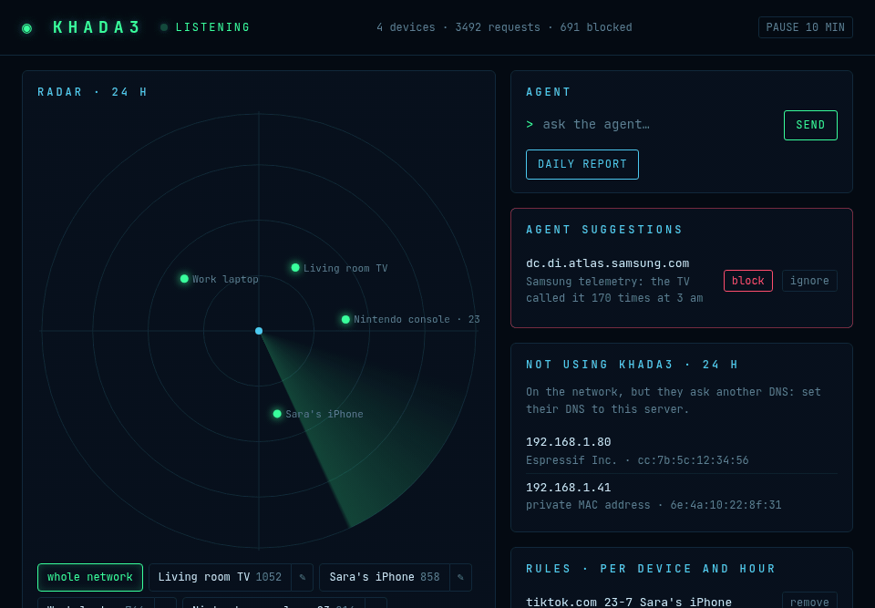

# khada3

**A home DNS server that shows who every device on your network is talking to, and an AI agent that explains it in plain words.**

*Khada3* means "traitor" in Darija (North African Arabic). Your smart TV, phone and speakers report to dozens of servers every hour: they are the traitors, and khada3 tells on them.



<sub>Demo recorded with simulated devices (`docs/demo/`: fake network, recording script, GIF).</sub>

## What it does

- **Logs every DNS lookup, per device.** Point your network at khada3 and every domain each device looks up is recorded, over UDP and TCP.
- **Radar dashboard.** Each device is a blip: the busier it is, the closer it sits to the centre, and it pings on every new request. Devices show their maker (read from the MAC address) until you give them a name.
- **Who is behind each domain.** The company and what it does (advertising, analytics, social…) from the Disconnect tracker list, and the country of the server it answered from.
- **Blocks trackers.** About 80,000 ad and tracking domains from StevenBlack/hosts, updated weekly, plus your own `bloquer.txt`. Block or unblock any domain in one click; nothing needs a restart.
- **An agent that acts, with your permission.** Ask it anything ("which device talks to trackers the most?", "what was my TV doing at 3 am?"). Its daily report comes with suggestions to block, each with a reason: one click in the dashboard, or a button on Telegram. Suggestions left unanswered for a week expire and are not asked again.
- **Safe suggestions.** The agent can only suggest domains from a stricter curated list (Hagezi Pro) that are not blocked yet. When the model tried to suggest Android's connectivity check, this rule threw it out.
- **Timeline.** Requests hour by hour over the last 24 hours, for the whole network or one device; pick an hour to see what was looked up (what was the TV doing at 3 am?).
- **Smart alerts** on Telegram: a new device joins; a device contacts a company or a server country it never talked to before (after a one-day learning period); a device is suddenly busy at night (3× its usual hourly pace). At most 10 alerts an hour.
- **Never cuts your internet.** A second upstream server if the first one fails; already-visited sites keep working from the cache even when every upstream is down; and a systemd watchdog: khada3 asks itself a question every 10 seconds, and if it gets no answer for 30 seconds, it is restarted.
- **Works away from home** with [Tailscale](https://tailscale.com): make khada3 your tailnet's DNS server and your phone goes through it on 4G too. Devices coming through Tailscale are named automatically.
- **Rules per device and per hour** in `regles.txt`, one per line: `tiktok.com 23-7 Living room TV` blocks TikTok on that device from 23:00 to 07:00; `instagram.com 192.168.1.9` blocks it all day on that IP; `youtube.com 8-16` blocks it for every device during those hours. Edited live, no restart.
- **Pause blocking** when a site breaks: `/pause 10` on Telegram or the button on the dashboard, `/resume` to block again. Lists are untouched, everything comes back on its own.
- **Catches devices that slip away.** When a device looks up an encrypted DNS service (Google, Cloudflare, Quad9, NextDNS…) or iCloud Private Relay, its requests would stop going through khada3: you get a suggestion to block it, so the device falls back to khada3.
- **Spots devices that skip khada3 entirely.** A device on the Wi-Fi that never asks khada3 anything is using another DNS (usually the box's). Every 5 minutes khada3 reads the server's ARP table (no scan) and lists them on the dashboard, with one Telegram alert for each new one, so you know which devices to point at it.
- **Notices a device that quietly stops using it.** A device that usually talks a lot, is still on the network (it answers a ping), but has asked khada3 nothing for 2 hours has probably switched to its own encrypted DNS or iCloud Private Relay: one Telegram alert, until it comes back.
- **Private mode for family and guests.** Mark a device private (the ○ button next to it, even before it first uses khada3): it is still filtered, but khada3 only keeps how many requests it made and how many were blocked. No domain, no habits, no suggestions, nothing in the AI report. Making a device private erases what was already stored.
- **Weekly report** on Sunday at 20:00, no AI needed: requests per device against the week before, devices that went silent for over a day, most blocked domains. It comes with a shareable card (lookups, blocked, devices, the companies that tracked you most, the countries your lookups went to; no IP address on it). The card needs `rsvg-convert` (`librsvg2-tools` on Fedora, `librsvg2-bin` on Debian); without it, you get the text only.
- A 30-day history, purged automatically.

## How it works

```
 devices ──DNS──▶ khada3.py ──▶ cache ──▶ upstream DNS (1.1.1.1, then 9.9.9.9)
                      │
                      ├─ blocked? ─▶ NXDOMAIN
                      ▼
                  khada3.db (SQLite) ◀── web.py + page.html (dashboard, port 8053)
                                       ◀── resume.py ──▶ Gemini ──▶ report + suggestions
                                       ◀── messager.py ◀──▶ Telegram (alerts, buttons, questions)
```

Plain Python 3 standard library: no dependencies, no framework. The DNS part only parses what it needs and forwards the raw packet, so answers are exactly what the upstream server sent. The lists and data files are downloaded into `listes/` at startup and refreshed in the background.

## Quick start

Try it on your own machine, without touching your network:

```sh
python3 khada3.py                      # DNS on 127.0.0.1:5300, dashboard URL printed at start
dig @127.0.0.1 -p 5300 example.com       # the lookup appears on the dashboard
python3 test_khada3.py                 # tests
```

To see your own computer's traffic on Linux with systemd-resolved (replace `wlan0` with your interface):

```sh
sudo resolvectl dns wlan0 127.0.0.1:5300   # route this machine's DNS through khada3
sudo resolvectl dns wlan0 <your router>    # undo
```

## On a home server

Run it on an always-on machine (an old laptop works fine) and listen on the network:

```sh
sudo KHADA3_ECOUTE=0.0.0.0 KHADA3_PORT=53 python3 khada3.py
```

Then set that machine's IP as the DNS server in your router's DHCP settings, or device by device. Every device then shows up on the radar.

As a systemd service, with the watchdog (`/etc/systemd/system/khada3.service`, adjust the user and paths):

```ini
[Unit]
Description=khada3
Wants=network-online.target
After=network-online.target

[Service]
User=you
WorkingDirectory=/home/you/khada3
Environment=KHADA3_ECOUTE=0.0.0.0 KHADA3_PORT=53 PYTHONUNBUFFERED=1
ExecStart=/usr/bin/python3 /home/you/khada3/khada3.py
AmbientCapabilities=CAP_NET_BIND_SERVICE
Restart=always
RestartSec=5
WatchdogSec=30
NotifyAccess=main

[Install]
WantedBy=multi-user.target
```

The daily report at 21:00: `cp rapport.service rapport.timer ~/.config/systemd/user/ && systemctl --user enable --now rapport.timer`; the weekly one the same way with `semaine.service` and `semaine.timer` (and `sudo loginctl enable-linger $USER` so it runs when you are logged out).

| Variable | Default | Meaning |
|---|---|---|
| `KHADA3_ECOUTE` | `127.0.0.1` | Address to listen on (`0.0.0.0` for the whole network) |
| `KHADA3_PORT` | `5300` | DNS port (`53` on a server) |
| `KHADA3_PORT_WEB` | `8053` | Dashboard port |
| `KHADA3_AMONT` | `1.1.1.1,9.9.9.9` | Upstream DNS servers, tried in order |
| `KHADA3_MODELE` | `gemini-3.1-flash-lite` | Gemini model used by the agent |
| `KHADA3_LANGUE` | `English` | Language of the daily report (questions are answered in the language they are asked in) |
| `KHADA3_LISTE_URL` | StevenBlack/hosts | Blocklist applied to everyone (empty to disable) |
| `KHADA3_CANDIDATS_URL` | Hagezi Pro | Stricter list the agent may pick suggestions from |

**AI agent:** put a [Gemini API key](https://aistudio.google.com/apikey) in `~/.config/khada3/cle` (`chmod 600`) or in `GEMINI_API_KEY`.

**Telegram:** create a bot with [@BotFather](https://t.me/BotFather), put its token in `~/.config/khada3/telegram` (`chmod 600`), start khada3 and send `/start` to your bot: the first chat that writes to it becomes its owner, and it ignores everyone else. Then you get alerts, the report with Block / Ignore buttons, and you can ask questions in the chat (`/report` for the report on demand, `/pause 10` and `/resume`). The report is sent by `python3 resume.py` (see the timer above).

## Honeypot (fakh)

Optional. `fakh.py` ("trap" in Darija) runs fake SSH, Telnet and web services and logs who tries to get in: the logins and passwords botnets try, the pages scanners look for (`/.env`, router admin pages), the client software. It never gives a shell: every connection is read, logged, then refused. The dashboard shows a **Trap** section (logins tried, countries, pages, live feed) and the daily report adds one line.

```sh
sudo useradd -r -s /sbin/nologin fakh
sudo install -Dm644 fakh.py /opt/fakh/fakh.py
sudo cp fakh.service /etc/systemd/system/ && sudo systemctl enable --now fakh
sudo firewall-cmd --permanent --add-port={2222,2323,8080}/tcp && sudo firewall-cmd --reload
```

Then forward ports 22, 23 and 80 of your router to ports 2222, 2323 and 8080 of the server. Never forward the real SSH port.
The service runs as its own user with no access to `/home`, a read-only system and a read-only copy of the code. khada3 only reads its database (`/var/lib/fakh/fakh.db`, or `KHADA3_FAKH`). Everything an attacker sends is cut to printable text and shown as text only.

## Privacy and security

- The DNS log is a browsing history. The dashboard refuses every request without the token stored in `~/.config/khada3/jeton` (created on first run). It is printed only when khada3 runs in a terminal, never into the systemd journal.
- Domain names come from the network and are never inserted as HTML in the page.
- The data stays on the machine, except the last 24 hours of domains sent to Gemini when the agent answers or writes the report, and the messages exchanged with your own Telegram bot.
- The Telegram bot only listens to the chat it was paired with.
- **Ask before logging someone else's device.** Even at home, a family member's DNS log is their browsing history: make their devices private unless they agree.
- **Only run khada3 on a network you own.** Logging other people's traffic on a school, office or public network without permission is illegal in most countries.

## Files

| File | Role |
|---|---|
| `khada3.py` | DNS server (UDP and TCP): cache, block, log, list updates |
| `web.py`, `page.html` | Dashboard and its API |
| `resume.py` | The agent: daily report and suggestions; `--semaine` for the weekly report; `--ecran` prints instead of sending |
| `qui.py` | Company, activity and server country of a domain |
| `messager.py` | Telegram: alerts, buttons, questions |
| `bloquer.txt` | Your own blocklist, one domain per line |
| `regles.txt` | Optional: `domain [hours] [device]` rules (device = IP or the name given in the dashboard) |
| `rapport.service`, `rapport.timer` | Daily report at 21:00 (systemd user timer) |
| `semaine.service`, `semaine.timer` | Weekly report, Sunday 20:00 (`resume.py --semaine`) |
| `fakh.py`, `fakh.service` | Optional honeypot (see above) |
| `test_khada3.py`, `test_fakh.py` | Tests |
| `docs/demo/` | Demo GIF: `gen.py` builds a fake network, `record.mjs` films it in headless Chrome, `gif.sh` makes the GIF |

## Credits

[StevenBlack/hosts](https://github.com/StevenBlack/hosts) (blocklist) · [Hagezi DNS blocklists](https://github.com/hagezi/dns-blocklists) (suggestions) · [Disconnect tracker list](https://disconnect.me/trackerprotection) (companies) · [IP Geolocation by DB-IP](https://db-ip.com) (countries, CC BY 4.0) · maker names from the IEEE OUI list (`hwdata` package).

## Contributing

See [CONTRIBUTING.md](CONTRIBUTING.md). Run `python3 test_khada3.py` before opening a pull request.

## License

MIT
